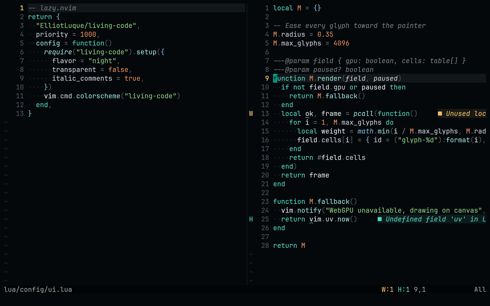
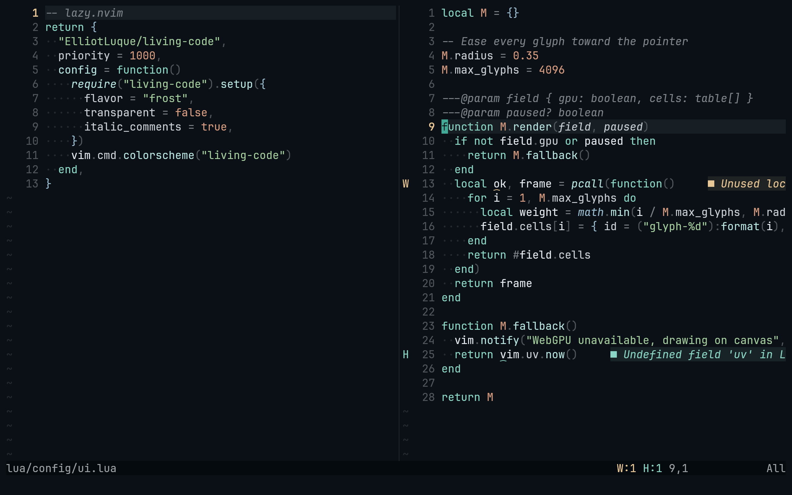
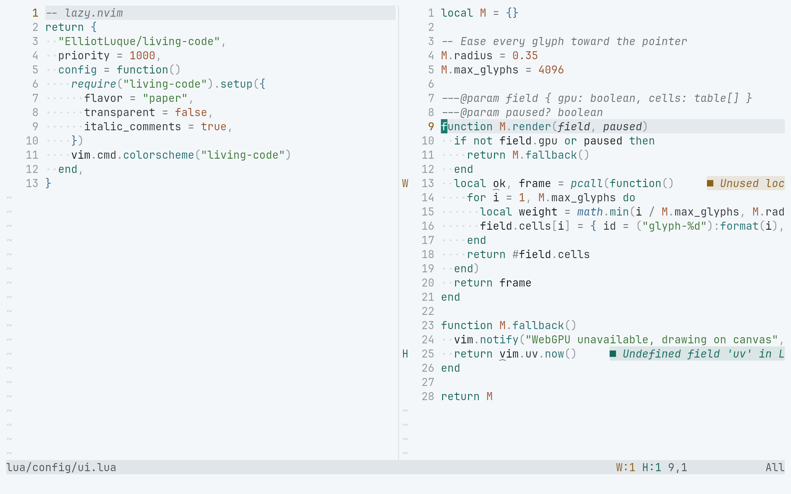
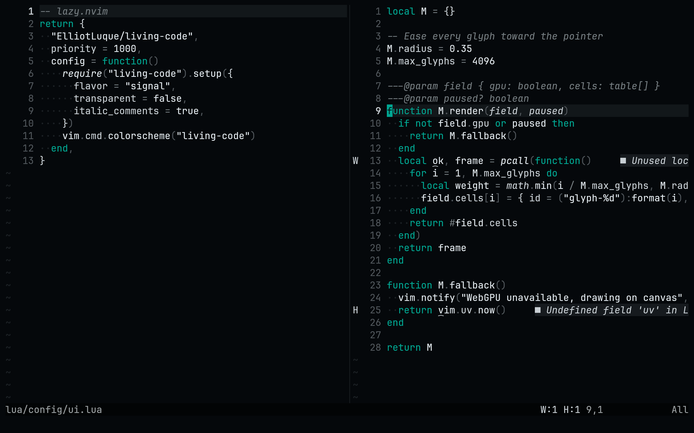

<!-- living-code-readme:1 -->
# Living Code for Neovim

**Calm slate. Living color.** Living Code for Neovim. Four color flavors, Tree-sitter and LSP highlights, and lualine integration.

[Installation](#installation) · [Flavors](#flavors) · [Configuration](#configuration) · [All ports](https://github.com/living-code-theme)

## Previews

<table data-lc-flavors>
<tr>
<td width="50%" valign="top">
<strong>Night</strong><br><sub>Dark · full palette</sub><br><br>
<a href="images/night.png"></a>
</td>
<td width="50%" valign="top">
<strong>Frost</strong><br><sub>Dark · softer chroma</sub><br><br>
<a href="images/frost.png"></a>
</td>
</tr>
<tr>
<td width="50%" valign="top">
<strong>Paper</strong><br><sub>Light · near-white slate</sub><br><br>
<a href="images/paper.png"></a>
</td>
<td width="50%" valign="top">
<strong>Signal</strong><br><sub>Dark · teal accent</sub><br><br>
<a href="images/signal.png"></a>
</td>
</tr>
</table>

Select any preview to view the image at full size.

## Installation

Install with your plugin manager. For lazy.nvim:

```lua
{
  "living-code-theme/nvim",
  priority = 1000,
  config = function()
    require("living-code").setup({
      flavor = "night",
      transparent = false,
      italic_comments = true,
    })
    vim.cmd.colorscheme("living-code")
  end,
}
```

Or pick a flavor directly: `:colorscheme living-code-signal`. Covers Tree-sitter, LSP semantic tokens, diagnostics, gitsigns, telescope, nvim-cmp / blink.cmp, which-key, mini.*, lualine (`theme = "living-code"`).

## Flavors

Expand a flavor for its full-size preview and activation instructions.

<details data-lc-flavor="night">
<summary><strong>Night</strong> · Dark · full palette</summary>

<p><a href="images/night.png"></a></p>

Activate this flavor directly:

```vim
:colorscheme living-code-night
```

Or set `flavor = "night"` in `require("living-code").setup()` before loading `living-code`.

</details>

<details data-lc-flavor="frost">
<summary><strong>Frost</strong> · Dark · softer chroma</summary>

<p><a href="images/frost.png"></a></p>

Activate this flavor directly:

```vim
:colorscheme living-code-frost
```

Or set `flavor = "frost"` in `require("living-code").setup()` before loading `living-code`.

</details>

<details data-lc-flavor="paper">
<summary><strong>Paper</strong> · Light · near-white slate</summary>

<p><a href="images/paper.png"></a></p>

Activate this flavor directly:

```vim
:colorscheme living-code-paper
```

Or set `flavor = "paper"` in `require("living-code").setup()` before loading `living-code`.

</details>

<details data-lc-flavor="signal">
<summary><strong>Signal</strong> · Dark · teal accent</summary>

<p><a href="images/signal.png"></a></p>

Activate this flavor directly:

```vim
:colorscheme living-code-signal
```

Or set `flavor = "signal"` in `require("living-code").setup()` before loading `living-code`.

</details>

## Configuration

Call setup before loading the colorscheme. All options are optional:

```lua
require("living-code").setup({
  flavor = "night",
  light_flavor = "paper",
  transparent = false,
  italic_comments = true,
  dim_inactive = false,
  on_highlights = nil,
})
vim.cmd.colorscheme("living-code")
```

With `background=light`, the default colorscheme selects `light_flavor`. A flavor-specific colorscheme always loads that flavor. For lualine, use `theme = "living-code"`.

## Compatibility

Uses Neovim's Lua highlight API and true color. Includes Tree-sitter, LSP semantic tokens, diagnostics, gitsigns, telescope, nvim-cmp / blink.cmp, which-key, mini.* and lualine highlights. Plugin integrations are optional; install the plugins you use separately.

## Contributing

Report installation issues and include the application version and selected flavor. For visual changes, include a real application screenshot. Keep this README, `port.json` and `images/` in sync; do not add generated mockups.

## License

[MIT](LICENSE) © Elliot Luque
